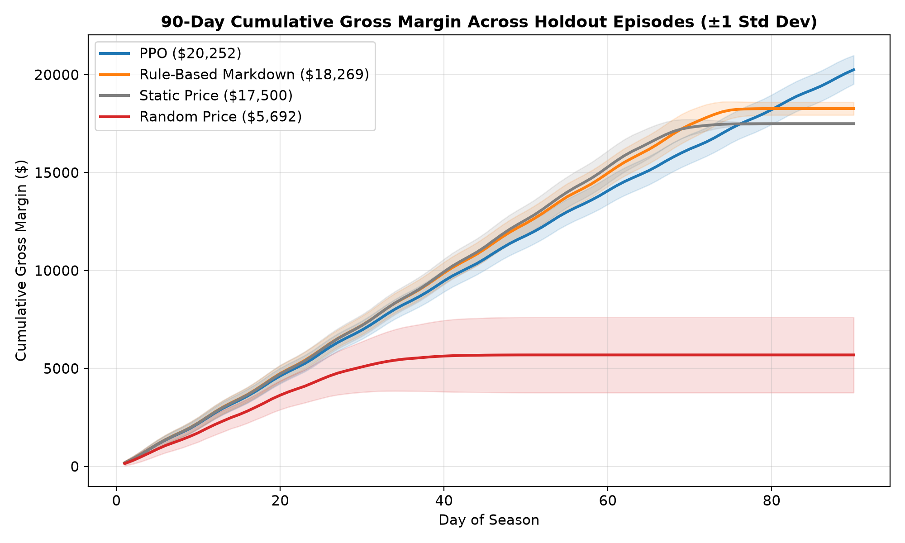
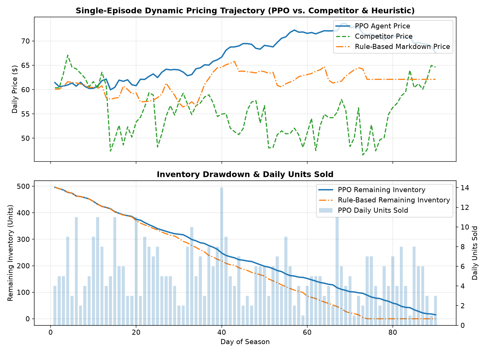
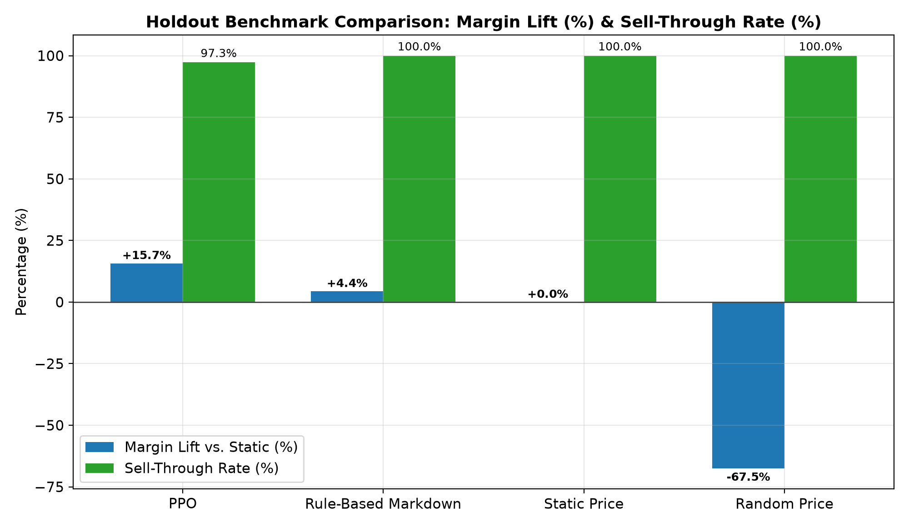

# PriceGym: Reinforcement Learning Dynamic Pricing Simulator & Inference Suite

**PriceGym** is a production-grade Reinforcement Learning (RL) dynamic pricing simulator, benchmarking suite, and low-latency ONNX inference service designed for seasonal e-commerce revenue management.

It models the real-world merchant challenge of pricing a finite inventory of a seasonal SKU across a fixed selling horizon under stochastic customer demand, own-price and cross-price competitor elasticity, weekly/seasonal traffic cycles, and inventory holding/salvage costs.

---

## 1. Project Overview & Core Functionalities

### A. Stochastic Market & Demand Engine (`src/price_gym/utils/demand.py`)
Simulates realistic daily customer arrival and purchasing behavior driven by configurable economic parameters (`configs/default.yaml`):
- **Own-Price & Cross-Price Elasticity:** Daily expected demand responds non-linearly to the merchant's price $P_t$ relative to a reference price $P_{\text{ref}}$ ($\epsilon = 1.85$) and the competitor's price $P_{\text{comp}, t}$ ($\gamma = 0.75$):
  $$\mathbb{E}[D_t] = D_{\text{base}} \cdot \left(\frac{P_t}{P_{\text{ref}}}\right)^{-\epsilon} \cdot \left(\frac{P_{\text{comp}, t}}{P_t}\right)^{\gamma} \cdot S(t) \cdot \xi_t$$
- **Multi-Scale Seasonality ($S(t)$):** Combines a 7-day sinusoidal cycle (weekend shopping peaks) with a 90-day seasonal curve (mid-season peak).
- **Competitor Price Dynamics:** Models competitor pricing via a discrete Ornstein-Uhlenbeck (mean-reverting random walk) process around $P_{\text{ref}} = \$60.00$, punctuated by stochastic promotional flash drops ($8\%$ daily probability of a $20\%$ discount).
- **Stochastic Demand Realization:** Applies bounded multiplicative daily demand shocks $\xi_t \in [0.75, 1.25]$ and samples actual customer arrivals from a Poisson distribution, clipped to available physical inventory. All randomness is strictly routed through the environment's `np.random.Generator` for 100% deterministic seeding.

### B. Custom Gymnasium Environment (`src/price_gym/envs/pricing_env.py`)
Implements `DynamicPricingEnv(gym.Env)` compliant with Gymnasium 1.4+:
- **Episode Horizon & Inventory:** Default 90-day selling season starting with 500 units of inventory ($C = \$25.00$ unit cost, price bounds $[\$20.00, \$100.00]$). Terminates early on stockout (`inventory == 0`) or truncates at Day 90.
- **Natively Normalized 7-D Observation Space (`Box`, `float32`):** Eliminates the need to serialize external `VecNormalize` running statistics at inference time:
  1. `inventory_ratio` $\in [0, 1]$: Remaining stock divided by initial stock.
  2. `time_remaining_ratio` $\in [0, 1]$: Fraction of the 90-day selling season remaining.
  3. `norm_prev_price` $\in [0, 1]$: Previous day's price normalized across $[P_{\min}, P_{\max}]$.
  4. `norm_comp_price` $\in [0, 1]$: Today's competitor price normalized across $[P_{\min}, P_{\max}]$.
  5. `seasonality_sin` $\in [-1, 1]$ & 6. `seasonality_cos` $\in [-1, 1]$: Cyclical time encodings.
  7. `norm_rolling_demand` $\in [0, 1]$: 7-day rolling average units sold normalized by $2 \times D_{\text{base}}$.
- **Continuous Action Space (`Box`, `float32`, `[-1.0, 1.0]`):** Maps linearly to continuous prices in $[\$20.00, \$100.00]$.
- **Multi-Objective Reward Shaping:** Balances gross margin against brand-damaging price erraticism and inventory costs:
  $$R_t = \frac{1}{\text{scale}} \Big( \underbrace{(P_t - C) \cdot Q_t}_{\text{Gross Margin}} - \underbrace{\lambda_{\text{vol}} \left(\frac{P_t - P_{t-1}}{P_{\text{ref}}}\right)^2}_{\text{Volatility Penalty}} - \underbrace{h \cdot I_t}_{\text{Holding Cost}} - \underbrace{\mathbb{I}_{t = T} \cdot d \cdot I_T}_{\text{Dead-Stock Penalty}} \Big)$$

### C. Baseline Policies & RL Training Pipeline (`src/price_gym/agents/baselines.py`, `scripts/train.py`)
- **Benchmark Baselines:**
  - `StaticPriceAgent`: Fixed reference pricing ($P_t = \$60.00$).
  - `RuleBasedMarkdownAgent`: Domain heuristic that anchors 70% to reference price and 30% to competitor price, compares `inventory_ratio` against `time_remaining_ratio` to discount up to 30% when inventory lags behind schedule or mark up up to 20% when stock is scarce, reacts to 7-day demand surges, and smooths daily price transitions.
  - `RandomPriceAgent`: Uniform random price exploration baseline.
- **Vectorized RL Training:** Supports both **PPO** and **SAC** (`stable-baselines3`) across vectorized CPU environments (`make_vec_env`), logging metrics to TensorBoard and saving the best validation checkpoint via `EvalCallback`.

### D. 500-Episode Holdout Evaluation Suite (`src/price_gym/utils/metrics.py`, `scripts/evaluate.py`)
Evaluates trained RL checkpoints (`deterministic=True`) alongside all baseline policies across **500 unseen holdout seeds** (`10000..10499`, strictly disjoint from training/validation seeds) and generates high-DPI diagnostic visualizations.

### E. Low-Latency ONNX Export & FastAPI Inference Service (`scripts/export_onnx.py`, `src/price_gym/api/app.py`)
- **Zero-Overhead ONNX Export:** Wraps the trained Stable-Baselines3 deterministic actor network into a standalone `torch.nn.Module`, exports to `artifacts/models/policy.onnx` (opset 17), verifies numerical parity against PyTorch (`max |diff| = 2.38e-07 <= 1e-5`), and benchmarks single-sample CPU latency across 1,000 calls.
- **Real-Time FastAPI Service:** Loads `policy.onnx` into an `onnxruntime.InferenceSession` (`CPUExecutionProvider`) on startup and exposes:
  - `GET /health`: Model status and file path check.
  - `POST /predict-price`: Validates raw SKU state with Pydantic, constructs the 7-D normalized observation vector on the fly, runs sub-millisecond ONNX inference, and returns `recommended_price`, `expected_margin_per_unit`, and `inference_latency_ms`.

---

## 2. Holdout Benchmark & ONNX Latency Results

### A. 500-Episode Holdout Policy Benchmark (`seeds 10000..10499`)

| Agent / Policy | Mean Gross Margin ($) | Lift vs. Static (%) | Lift vs. Rule-Based (%) | Sell-Through (%) | Stockout Rate (%) | Daily Price Volatility ($) |
| :--- | :---: | :---: | :---: | :---: | :---: | :---: |
| **PPO (200k Steps)** | **$20,252.22 ± $731.77** | **+15.73%** | **+10.86%** | **97.30%** | **14.00%** | **$0.50** |
| **Rule-Based Markdown** | $18,268.97 ± $329.11 | +4.39% | +0.00% | 100.00% | 100.00% | $0.73 |
| **Static Price** | $17,500.00 ± $0.00 | +0.00% | -4.21% | 100.00% | 100.00% | $0.00 |
| **Random Price** | $5,691.58 ± $1,923.04 | -67.48% | -68.85% | 100.00% | 100.00% | $26.30 |

### B. ONNX Runtime CPU Inference Latency & Parity (1,000 Calls, `batch_size=1`)

| Metric | Value |
| :--- | :---: |
| **PyTorch vs. ONNX Max Absolute Difference** | `2.38e-07` (`atol=1e-5` passed) |
| **Mean Latency** | **0.0184 ms** (18.4 µs) |
| **p50 (Median) Latency** | **0.0183 ms** (18.3 µs) |
| **p95 Latency** | **0.0222 ms** (22.2 µs) |
| **p99 Latency** | **0.0370 ms** (37.0 µs) |
| **Training Simulation Throughput (4 Vectorized Envs)** | **1,306.5 steps/sec** |

---

## 3. Visual Analysis: What the Evaluation Graphs Show

### 1. Cumulative Gross Margin Over the 90-Day Season


**What this graph shows:**
- Plots the mean cumulative gross margin ($) earned from Day 1 to Day 90 across all 500 holdout episodes, with shaded $\pm 1$ standard deviation bands.
- **Why Static and Rule-Based plateau early:** Look closely at the grey (`Static Price`) and orange (`Rule-Based Markdown`) curves around **Day 65–75**. Both curves flatten out completely into a horizontal line! Because they price too low relative to peak mid-season demand, they **exhaust all 500 units of inventory 15–25 days before the season ends** (100% stockout rate). For the final three weeks of the season, they have zero units left to sell and earn \$0/day.
- **How PPO wins (+15.73% lift):** The blue `PPO` curve climbs steadily through the entire 90-day horizon, reaching **$20,252** (nearly **+$2,000 more profit per SKU** than the rule-based heuristic and **+$2,752 more** than static pricing). By charging a higher optimal price early and mid-season, PPO captures higher unit margin and preserves inventory so it can keep selling right up to Day 90.

---

### 2. Single-Episode Dynamic Pricing Trajectory & Inventory Drawdown


**What this graph shows:**
- **Top Panel (Daily Price Trajectory):** Compares the daily pricing decisions of the **PPO Agent** (solid blue) against the **Competitor Price** (dashed green, showing mean-reverting noise and sharp promotional drops to ~\$48) and the **Rule-Based Markdown Heuristic** (dash-dot orange) over a representative 90-day episode.
  - Notice that PPO learns to price in the **$65–$72 range** during the high-demand mid-season window (earning \$40–\$47 margin per unit instead of \$35), while keeping its day-to-day price adjustments remarkably smooth (**$0.50/day mean volatility**, even smoother than the rule-based heuristic's **$0.73/day**).
  - Rather than panic-matching every 1-day competitor flash sale (which would sacrifice margin when inventory is already scarce), PPO maintains price discipline and gently tapers price late in the season to clear remaining stock before Day 90.
- **Bottom Panel (Inventory Drawdown & Daily Units Sold):**
  - The orange dash-dot line (`Rule-Based Remaining Inventory`) hits **0 units around Day 78**, resulting in a premature stockout and lost late-season revenue.
  - The solid blue line (`PPO Remaining Inventory`) paces inventory depletion smoothly across the entire 90-day season, finishing near zero right at the Day 90 deadline while avoiding both early stockouts and end-of-season dead-stock penalties.

---

### 3. Benchmark Metrics Comparison: Margin Lift & Sell-Through Rate


**What this graph shows:**
- Compares **Margin Lift vs. Static (%)** (blue bars) alongside **Sell-Through Rate (%)** (green bars) across all evaluated policies.
- **The Revenue Management Trade-off:** A naive merchant often thinks "100% sell-through is always best." However, as the chart illustrates, `Static Price`, `Rule-Based Markdown`, and `Random Price` all achieve `100.0%` sell-through simply because they run out of stock early.
- **Optimal Inventory Pacing:** `PPO` achieves a **97.3% sell-through rate** (selling ~486.5 of the 500 units on average, cutting the stockout rate from 100% down to 14%) while unlocking a **+15.7% gross margin lift** over static pricing and outperforming the rule-based markdown heuristic by **+10.9%**.

---

## 4. Repository Structure

```text
PriceGym/
├── configs/
│   └── default.yaml          # Market, demand elasticity, reward, and RL hyperparameters
├── src/
│   └── price_gym/
│       ├── __init__.py
│       ├── envs/
│       │   ├── __init__.py
│       │   └── pricing_env.py # Custom Gymnasium environment
│       ├── agents/
│       │   ├── __init__.py
│       │   └── baselines.py   # Static, random, and rule-based markdown policies
│       ├── utils/
│       │   ├── __init__.py
│       │   ├── demand.py      # Elasticity, seasonality, competitor & shock math
│       │   └── metrics.py     # Margin lift, sell-through, volatility, latency helpers
│       └── api/
│           ├── __init__.py
│           └── app.py         # FastAPI + ONNX Runtime real-time pricing endpoint
├── scripts/
│   ├── train.py               # CLI training entrypoint (supports PPO and SAC)
│   ├── evaluate.py            # Holdout evaluation (500 episodes) + chart generation
│   └── export_onnx.py         # Export trained SB3 policy to ONNX + parity & latency test
├── tests/
│   ├── test_env.py            # Gymnasium check_env() + unit/edge-case tests
│   └── test_api.py            # FastAPI endpoint tests
├── artifacts/
│   ├── .gitkeep
│   └── plots/                 # Saved PNG evaluation charts
├── .gitignore
├── pyproject.toml             # Editable package config (src layout) + dependencies
└── README.md                  # Architecture, setup, benchmark tables, and charts
```

---

## 5. Quickstart & Usage

### Installation
```bash
pip install -e .
```

### Run Unit & Environment Compliance Tests
```bash
pytest tests/test_env.py
```

### Train an RL Pricing Policy (PPO or SAC)
```bash
python scripts/train.py --config configs/default.yaml --algo ppo --timesteps 200000 --n-envs 4 --seed 42
```

### Run 500-Episode Holdout Evaluation & Generate Plots
```bash
python scripts/evaluate.py --config configs/default.yaml
```

### Export Trained Policy to ONNX & Benchmark CPU Latency
```bash
python scripts/export_onnx.py --model-path artifacts/models/ppo_best/best_model.zip --algo ppo --output artifacts/models/policy.onnx --runs 1000
```

### Start the Real-Time FastAPI Pricing Server
```bash
uvicorn price_gym.api.app:app --host 0.0.0.0 --port 8000
```

Example request to `POST /predict-price`:
```bash
curl -X POST "http://localhost:8000/predict-price" \
  -H "Content-Type: application/json" \
  -d '{
    "current_inventory": 320,
    "initial_inventory": 500,
    "current_day": 35,
    "episode_days": 90,
    "prev_price": 58.50,
    "comp_price": 61.00,
    "rolling_7d_demand": 5.8
  }'
```

### Run Full Test Suite (Environment + FastAPI Endpoints)
```bash
pytest
```

---

## 6. How to Use PriceGym for Your Own E-Commerce Store

Merchants, data science teams, and marketplace sellers (e.g., Shopify, Amazon Seller Central, WooCommerce) can integrate PriceGym into their pricing workflow in three stages—without risking live revenue during RL exploration.

### Stage 1: Calibrate the Simulator to Your SKU (`configs/default.yaml`)
Use your historical order and inventory data to configure your SKU's economics in `configs/default.yaml`:
- **`episode_days` & `initial_inventory`**: Set to your seasonal selling window (e.g., `90` days for Q4 Holiday or Summer Collection) and starting warehouse/3PL stock allocation (e.g., `500` units).
- **`min_price`, `max_price`, `ref_price`, `unit_cost`**: Set your clearance floor (`min_price`), brand ceiling (`max_price`), standard MSRP (`ref_price`), and landed COGS + fulfillment fee (`unit_cost`).
- **`base_demand`, `elasticity`, `cross_elasticity`**: Estimate average daily unit sales at MSRP (`base_demand`), own-price sensitivity from past promotions (`elasticity`), and sensitivity to competitor undercutting (`cross_elasticity`).

### Stage 2: Train & Backtest Offline Before Going Live
In retail, letting an untrained RL agent experiment directly on a live storefront is too risky. Instead, train and audit the agent in PriceGym's sandbox first:
1. **Train the custom policy (~2 minutes on CPU):**
   ```bash
   python scripts/train.py --config configs/default.yaml --algo ppo --timesteps 200000
   ```
   The agent simulates over **2,200 full 90-day selling seasons**, learning how to pace inventory across weekend traffic peaks, mid-season demand surges, and sudden competitor flash sales.
2. **Audit against your current markdown rules:**
   ```bash
   python scripts/evaluate.py --config configs/default.yaml
   ```
   Inspect the 500-episode holdout table and `artifacts/plots/pricing_trajectory.png` to verify that the learned policy beats your existing rule-based markdown schedule, maintains low daily price volatility, and clears inventory before the end of the season.

### Stage 3: Connect the ONNX / FastAPI Microservice to Your Storefront
Export the validated policy to ONNX (`python scripts/export_onnx.py`) and start the FastAPI server (`uvicorn price_gym.api.app:app --host 0.0.0.0 --port 8000`). You can then integrate `POST /predict-price` in two ways:

1. **Automated Storefront Repricer (Scheduled Cron / Airflow / n8n):**
   - Pull current warehouse stock (`current_inventory`) and 7-day average unit sales (`rolling_7d_demand`) from your **Shopify Admin API** or ERP.
   - Pull the competitor's current price (`comp_price`) from a price-monitoring feed (e.g., Keepa, Prisync, Google Shopping).
   - Send the state payload to `POST /predict-price` and push the returned `recommended_price` back to your storefront's Product Variant API.
2. **High-Throughput Real-Time Catalog Scoring:**
   - With a median CPU inference latency of **0.0183 ms (18.3 µs)**, a single lightweight worker can score **50,000+ SKUs per second**, enabling real-time price updates across large retail catalogs or flash-sale marketplaces with zero noticeable latency overhead.


